# Система оценки студентов (конфигурация с нуля)

## Задача
Разработать конфигурацию 1С для системы оценки студентов.
О каждом студенте хранится информация:
- ФИО, дата рождения, телефон, фото
- Семейное положение (женат / не женат)

Любой пользователь может проголосовать за студента по 5 критериям
(от 0 до 10):
- Красота
- Порядочность
- Остроумие
- Состоятельность
- Вредные привычки (чем выше оценка — тем хуже)

**Правила голосования:**
- Каждый пользователь может голосовать по каждому критерию
  не более одного раза.
- Пользователь может в любой момент отозвать свою оценку
  (кнопка «Сброс»).
- После отзыва повторное голосование невозможно — оценка
  считается равной 0, поле и кнопка скрываются.

**Контроль «один голос на пользователя»:**
При проведении документа выполняется проверка через запрос
к регистру `ЖурналГолосований`. Если пользователь уже голосовал
за этого студента — документ не проводится.

**Результат:**
Отчёт «Самые популярные студенты» — диаграмма и таблица
с рейтингом. В отчёте есть отбор по полю «Женат»: можно
показать всех студентов или только женатых/неженатых.

## О кейсе
Учебный проект: конфигурация 1С с нуля для системы оценки студентов.
Демонстрирует полный цикл разработки — от проектирования метаданных
до отчётов на СКД.

## Что реализовано

### Справочники
- **Студенты** — ФИО, дата рождения, телефон (с маской), фото, флаг «Женат»
- **Файлы** — хранение изображений через `ХранилищеЗначения`

### Документ «Проголосовать»
- Реквизиты: Студент, Пользователь, 5 критериев (0–10)
- Форма: фото студента, полосы регулирования, кнопки сброса
- Проведение: движения по регистру `ЖурналГолосований`
- Контроль: проверка «один голос на пользователя» при проведении

### Регистр сведений «ЖурналГолосований»
- Регистратор: документ «Проголосовать»
- Ресурсы: оценки по критериям, вычисляемый рейтинг, флаг «Женат»

### Роли и пользователи
- **Админ** — полные права
- **Пользователь** — доступ к справочникам и документам
- Настроены пользователи: Администратор, Эксперт1, Эксперт2

### Отчёт «Самые популярные студенты»
Отчёт на СКД, состоящий из двух частей:
- **Диаграмма** — сравнение студентов по всем критериям
- **Таблица** — рейтинг студентов с оценками

Особенности:
- Отбор по полю «Женат»: все / только женатые / только неженатые
- Условное оформление: выделение рейтинга и вредных привычек
  на диаграмме

## Технические решения
- Загрузка фото через `ПоместитьФайл` + `ХранилищеЗначения`
- Отображение фото при повторном открытии через `ПриЧтенииНаСервере`
- Динамическое скрытие полей через `Видимость = Ложь`
- Автозаполнение текущего пользователя через `ПользователиИнформационнойБазы.ТекущийПользователь()`
- Расчёт рейтинга: `(Красота + Порядочность + Остроумие + Состоятельность + 10 − ВредныеПривычки) / 5`
- Условное оформление в СКД для рейтинга и вредных привычек
- Контроль «один голос на пользователя» через запрос к регистру
  при проведении документа

## Скриншоты

### Интерфейс

#### Форма справочника «Студенты»
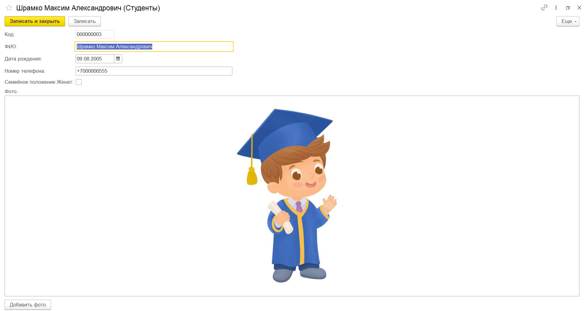

#### Документ «Проголосовать»
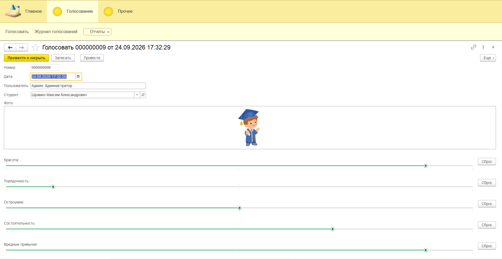

#### Журнал голосований
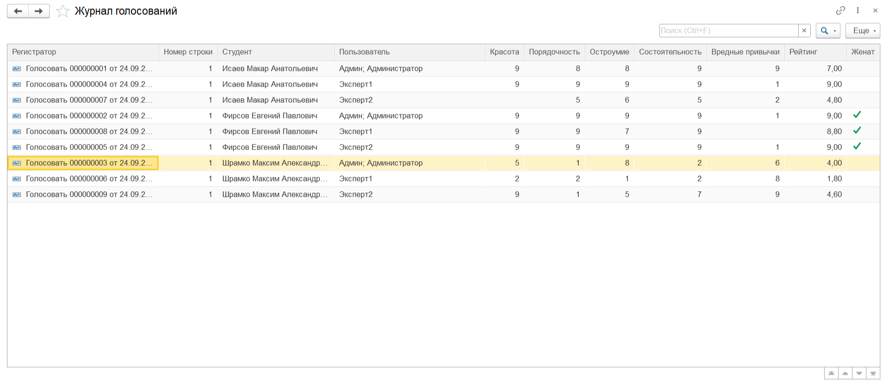

#### Отчёт «Самые популярные студенты» (диаграмма + таблица)
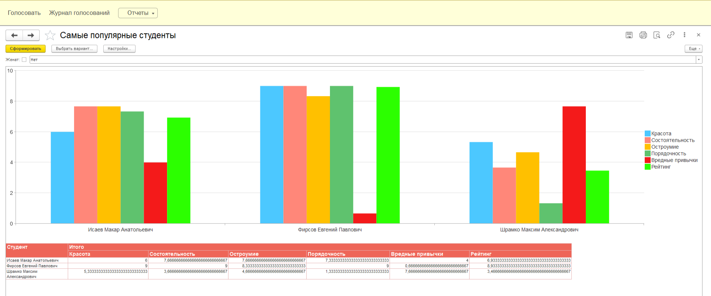

### Структура и настройки

#### Список пользователей
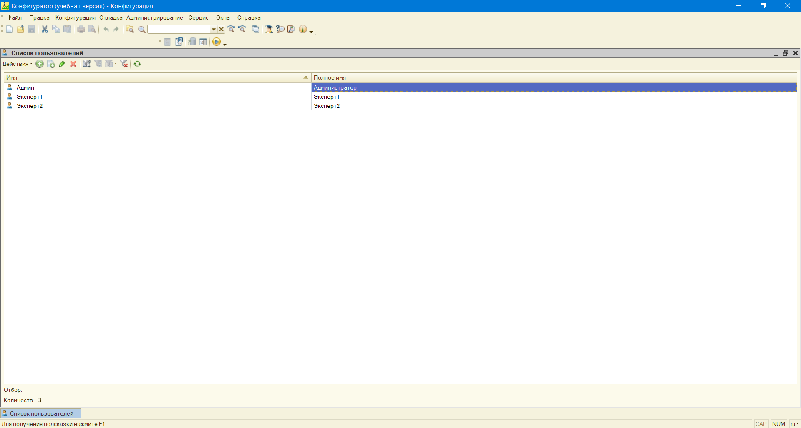

#### Настройки СКД отчёта
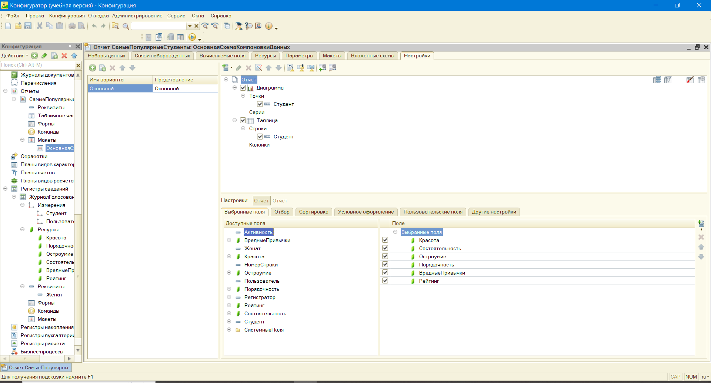

### Код

#### Сброс критериев и автозаполнение пользователя
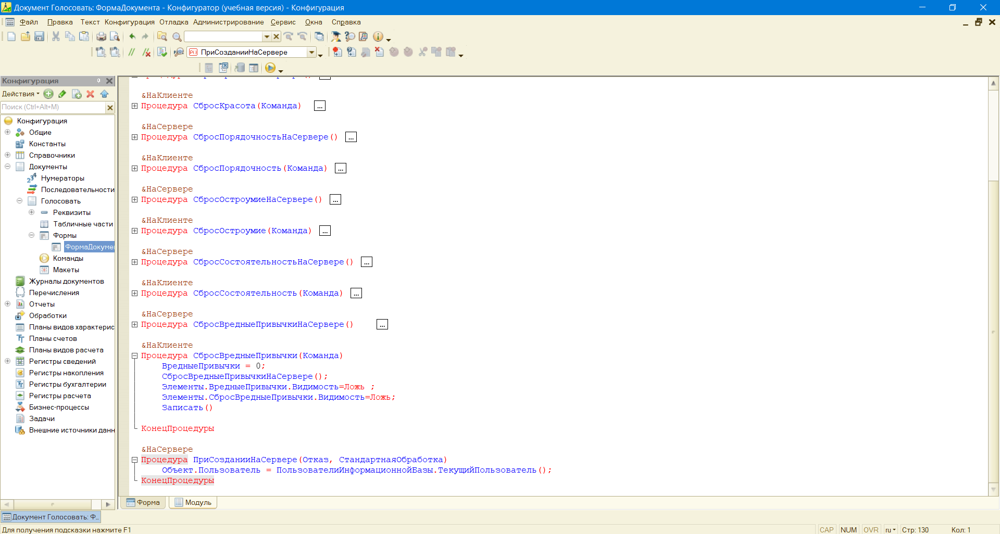

#### Логика формы документа: фото и изменение студента
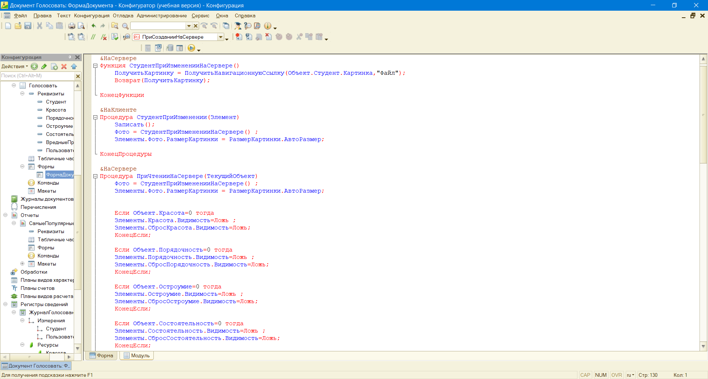

#### Проведение документа (движения по регистру)
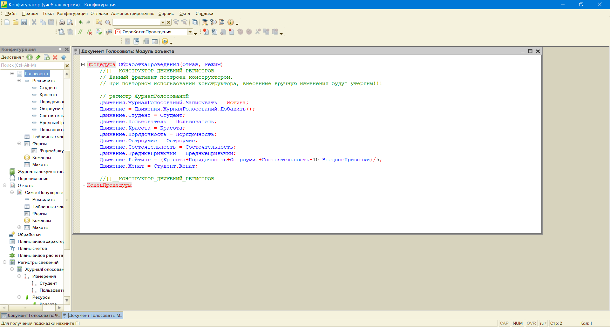

#### Загрузка фото в справочнике
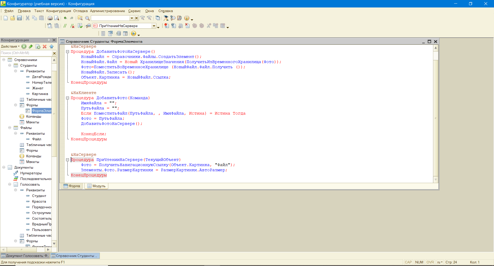

#### Контроль «один голос на пользователя»
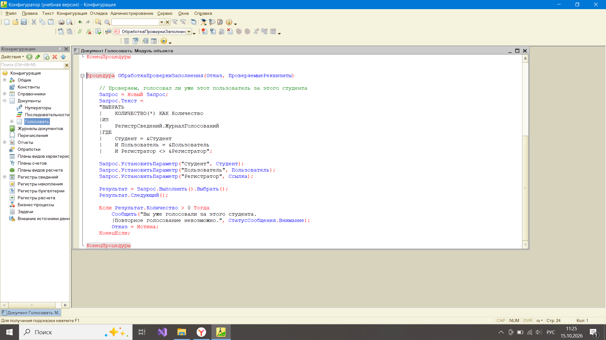

## Как развернуть

### Вариант 1: Загрузка из файлов
Конфигурация выгружена в файлы. Чтобы развернуть:
1. Создать новую пустую базу в 1С:Предприятие.
2. Открыть Конфигуратор.
3. **Конфигурация, Загрузить конфигурацию из файлов**, выбрать папку `src/`.
4. Обновить конфигурацию базы данных (F7).

### Вариант 2: Готовая база с демо-данными
В корне лежит файл `base.dt` — готовая информационная база
с тестовыми студентами и голосами. Развернуть:
1. Открыть 1С:Предприятие, **Администрирование, Загрузить информационную базу**.
2. Выбрать файл `base.dt`.

## Чему я научилась
- Проектировать метаданные с нуля
- Работать с хранилищем значений и файлами
- Писать код для форм (клиент + сервер)
- Делать движения по регистрам
- Настраивать роли и пользователей
- Строить отчёты на СКД с диаграммами, отборами
  и условным оформлением
- Реализовывать контроль данных через запросы при проведении