# Электронный кошелёк (конфигурация с нуля)

## О кейсе
Учебный проект: конфигурация 1С с нуля для учёта и анализа
прихода и расхода денежных средств по статьям, а также
взаиморасчётов с внешними лицами.

Демонстрирует полный цикл разработки учётной системы:
от проектирования метаданных до отчётов на СКД.

## Задача
Разработать программное средство, позволяющее:
- учитывать приход и расход денежных средств по статьям;
- вести взаиморасчёты с внешними лицами;
- анализировать движение денежных средств;
- формировать отчёты по видам затрат.

## Что реализовано

### Справочники
- **ВидыСтатейДоходовИРасходов** — группы статей (Поступления,
  Расходы на дом, Расходы на еду, Долг и др.)
- **СтатьиДоходовИРасходов** — конкретные статьи с привязкой к видам
- **Физические лица** — ФИО (автозаполнение наименования
  из фамилии, имени, отчества)

### Документы
- **ПоступлениеДенежныхСредств** — приход денег
- **РасходДенежныхСредств** — расход денег с контролем остатков
- **ПолучениеДенегВДолг** — получение денег в долг
- **ВозвратДолга** — возврат долга

### Регистры накопления
- **ДвижениеСредств** (вид «Остатки») — все документы
- **Взаиморасчёты** (вид «Остатки») — документы «Получение в долг»
  и «Возврат долга»

### Отчёты на СКД
- **Анализ движений денежных средств** — таблица с приходом
  и расходом по видам статей за период
- **Состояние взаиморасчётов** — долг на начало, займ, возврат, долг
- **Движение денежных средств** — график конечного остатка
- **Диаграмма по видам затрат** — столбчатая диаграмма расходов

## Технические решения
- **Проверка остатков при расходе** — запрос к регистру
  `ДвижениеСредств.Остатки`. Если сумма расхода превышает остаток —
  документ не проводится, выдаётся сообщение «Нет денег!»
- **Движения по двум регистрам** — документы «Получение в долг»
  и «Возврат долга» делают движения по `ДвижениеСредств`
  и `Взаиморасчёты`
- **Автозаполнение суммы документа** — через событие формы
  `СоставПриОкончанииРедактирования`: `Объект.Сумма =
  Объект.Состав.Итог("Сумма")`
- **Автозаполнение наименования физлица** — из фамилии, имени,
  отчества через события формы
- **Построение отчётов на СКД** — с группировками, ресурсами,
  диаграммами 

## Скриншоты

### Интерфейс

#### Главный экран
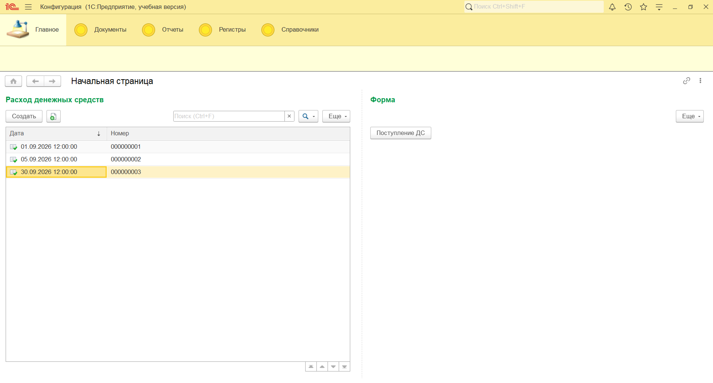

#### Справочник «Виды статей доходов и расходов»
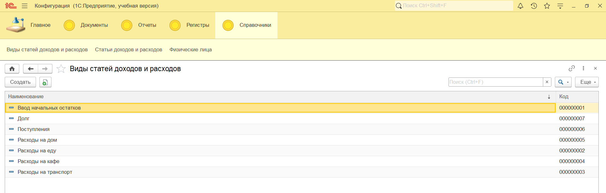

#### Справочник «Статьи доходов и расходов»
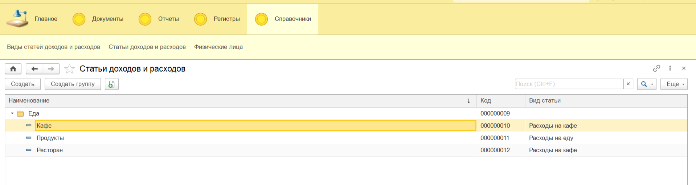

#### Справочник «Физические лица»
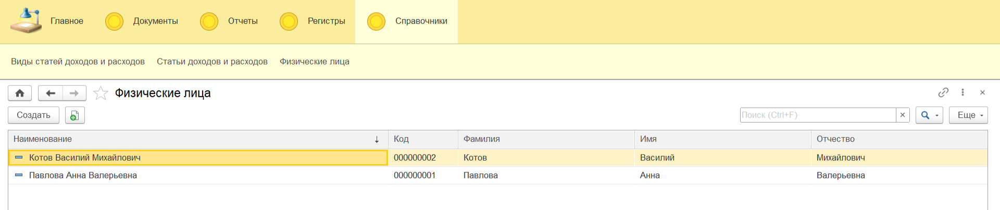

#### Документ «Поступление денежных средств»
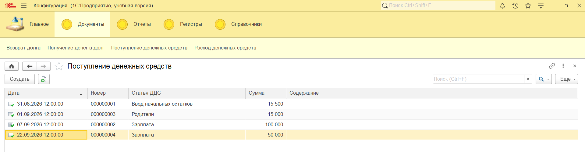

#### Документ «Расход денежных средств»
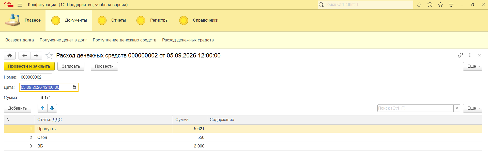

#### Документ «Получение денег в долг»
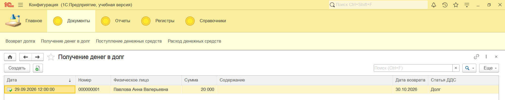

#### Документ «Возврат долга»
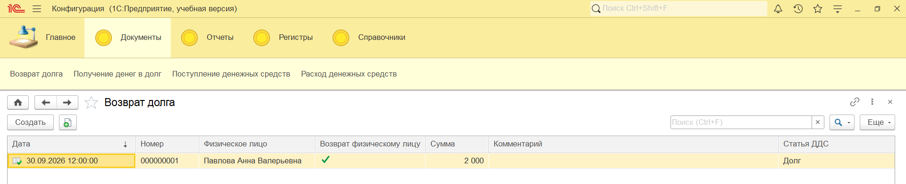

#### Регистр «Движение средств»
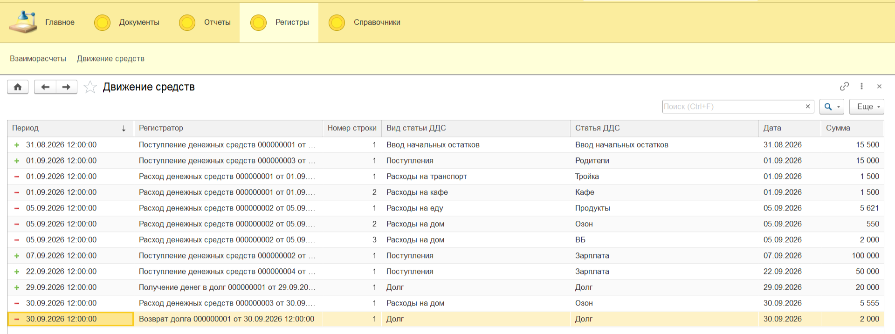

#### Регистр «Взаиморасчёты»
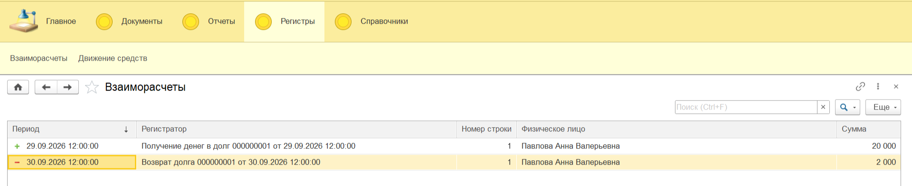

### Отчёты

#### Анализ движений денежных средств
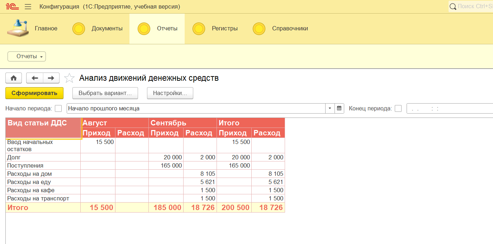

#### Состояние взаиморасчётов
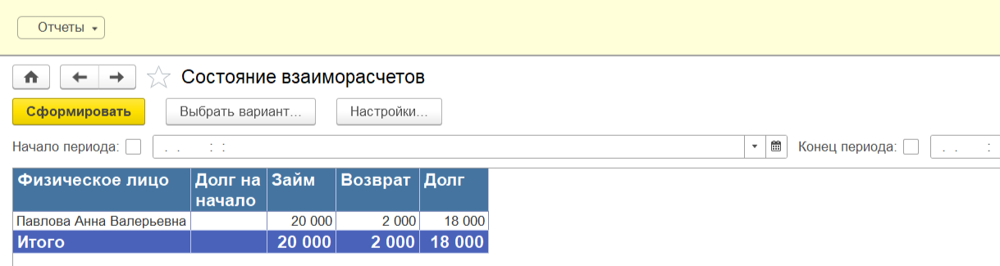

#### Движение денежных средств
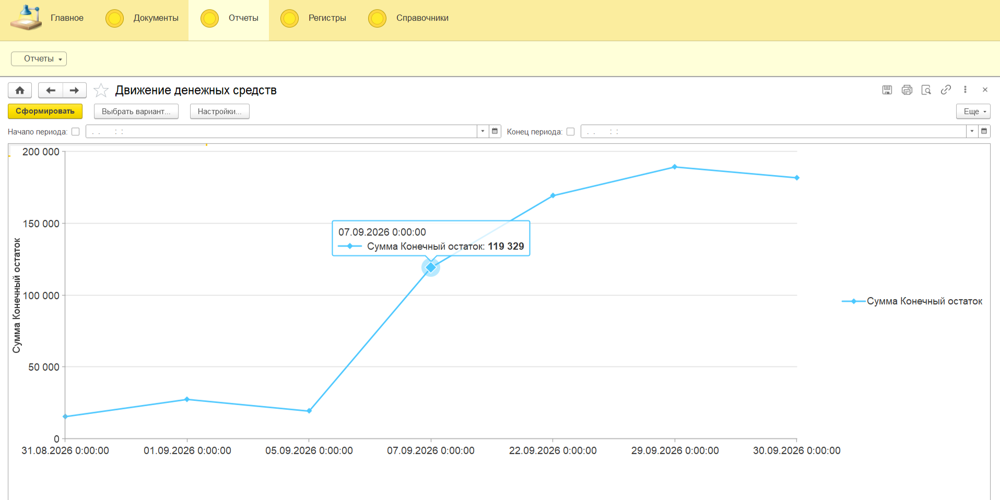

#### Диаграмма по видам затрат
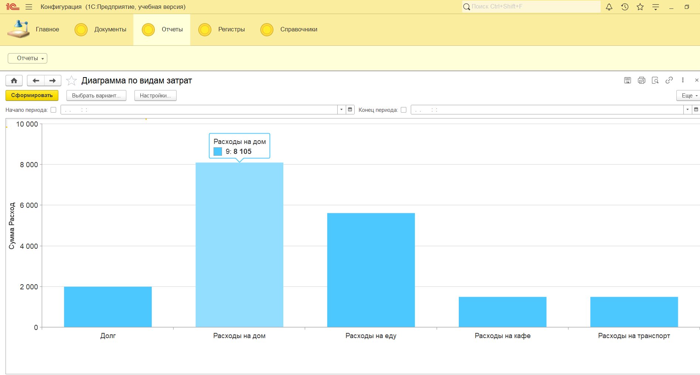

### Код

#### Проведение документа «Расход денежных средств» (с проверкой остатков)
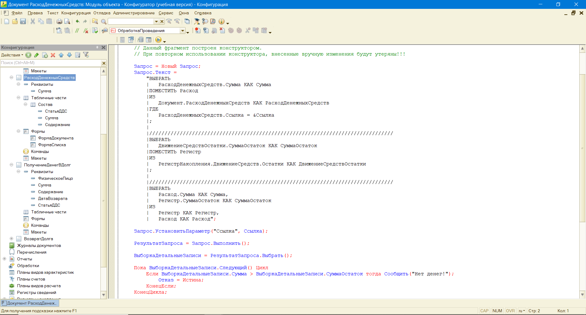

#### Проведение документа «Поступление денежных средств»
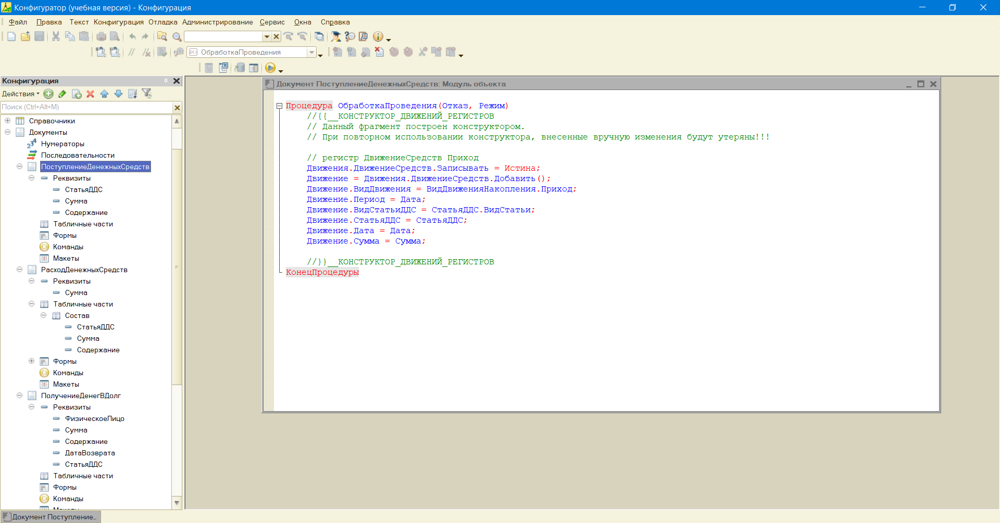

#### Проведение документа «Получение денег в долг»
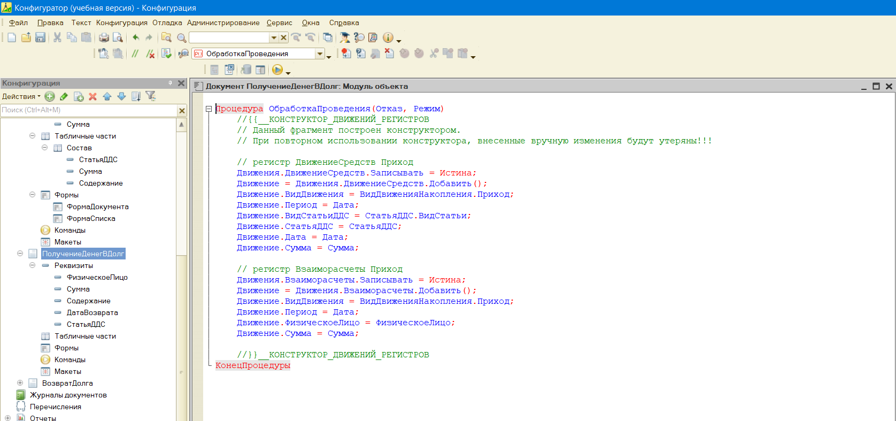

#### Проведение документа «Возврат долга»
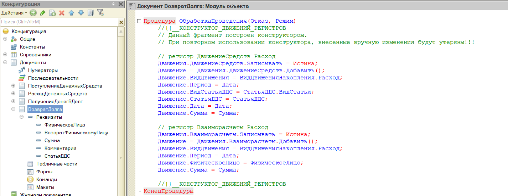

#### Автозаполнение суммы документа
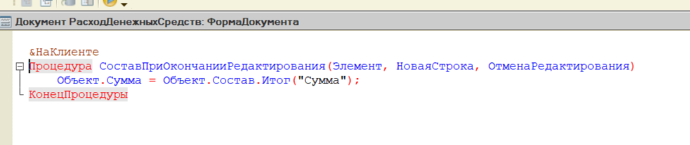

#### Автозаполнение наименования физлица
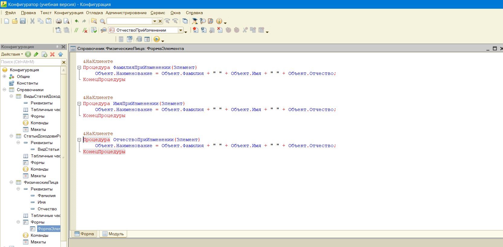

### Схемы компоновки данных

#### СКД отчёта «Анализ движений денежных средств»
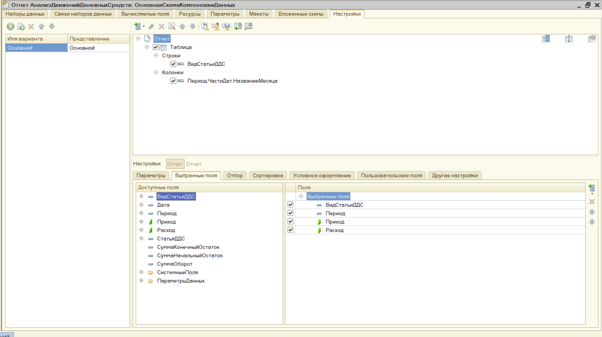

#### СКД отчёта «Состояние взаиморасчётов»
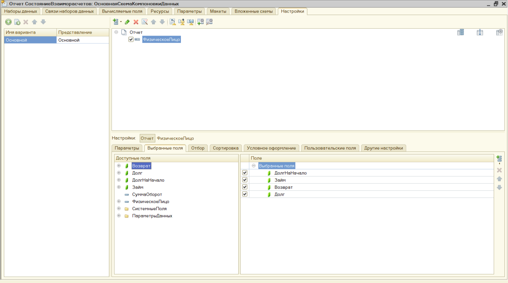

#### СКД отчёта «Движение денежных средств»
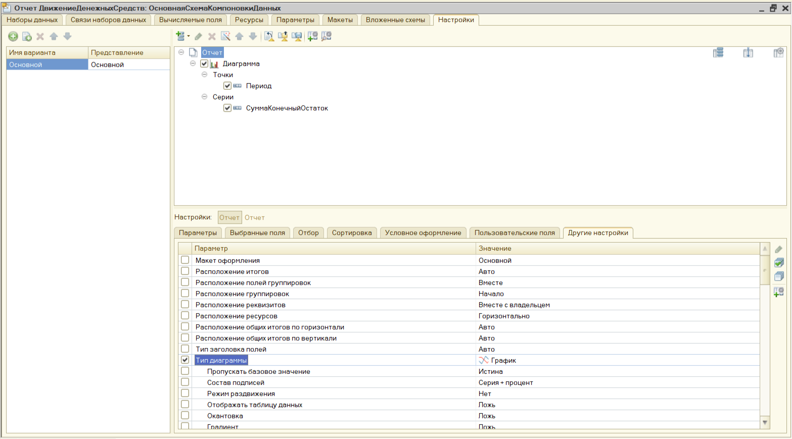

#### СКД отчёта «Диаграмма по видам затрат»
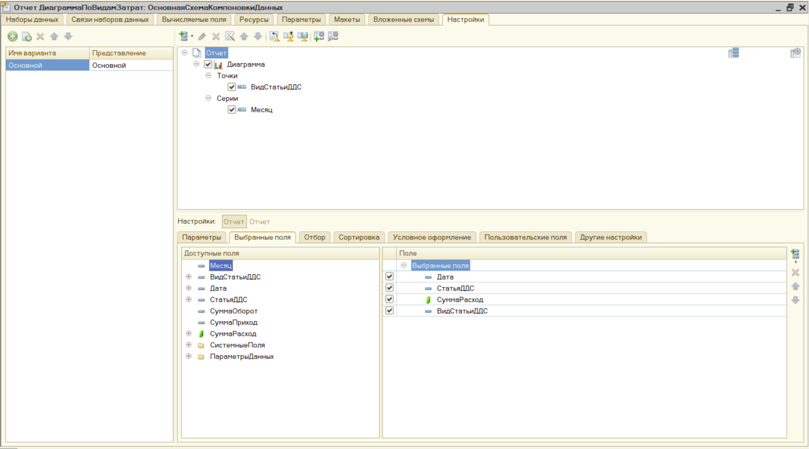

## Как развернуть

### Вариант 1: Загрузка из файлов
Конфигурация выгружена в файлы. Чтобы развернуть:
1. Создать новую пустую базу в 1С:Предприятие.
2. Открыть Конфигуратор.
3. **Конфигурация, Загрузить конфигурацию из файлов**, выбрать папку `src/`.
4. Обновить конфигурацию базы данных (F7).

### Вариант 2: Готовая база с демо-данными
В корне лежит файл `base.dt` — готовая информационная база
с тестовыми данными за неделю. Развернуть:
1. Открыть 1С:Предприятие, **Администрирование, Загрузить информационную базу**.
2. Выбрать файл `base.dt`.

## Чему я научилась
- Проектировать метаданные с нуля
- Работать с регистрами накопления (остатки)
- Делать движения по нескольким регистрам
- Реализовывать контроль данных через запросы при проведении
- Автоматически заполнять реквизиты через события формы
- Строить отчёты на СКД с таблицами, графиками и диаграммами
