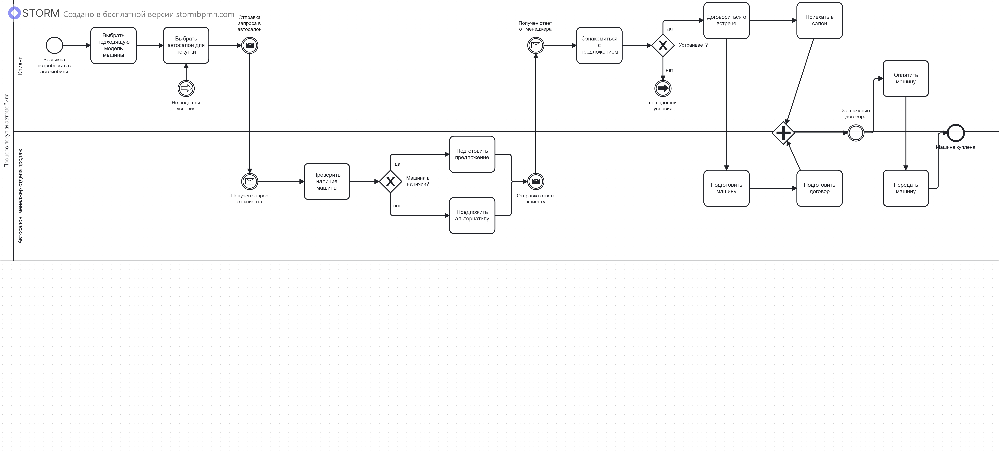
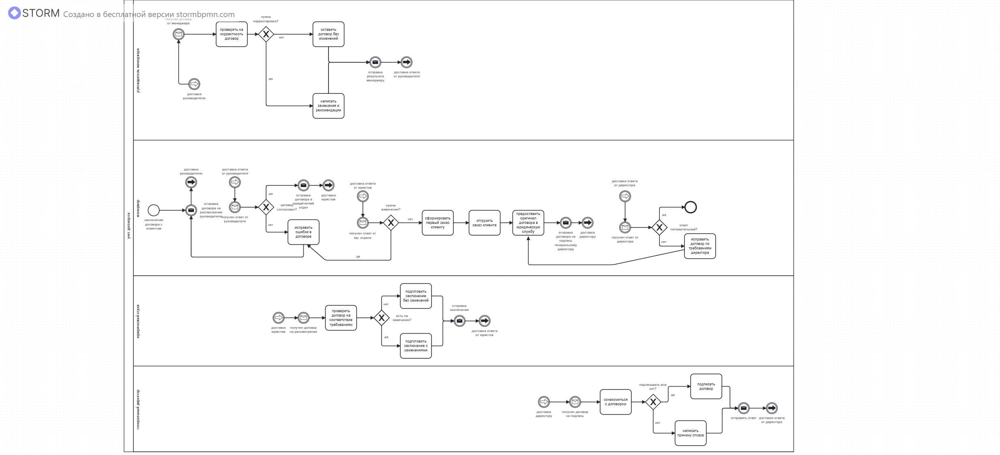

# Моделирование бизнес-процессов (BPMN)

## О кейсе
Учебный кейс: две BPMN-схемы бизнес-процессов, построенные
в Storm BPMN. Демонстрируют навык моделирования процессов
с дорожками, шлюзами и событиями.

*Схемы построены в бесплатной версии Storm BPMN.*

## Схемы

### 1. Процесс покупки автомобиля
**Роли:** Клиент, Автосалон (менеджер отдела продаж).

### 2. Согласование договора
**Роли:** Руководитель менеджера, Менеджер,
Юридический отдел, Генеральный директор.

## Чему я научилась
- Строить BPMN-схемы с дорожками
- Моделировать процессы с несколькими ролями
- Использовать эксклюзивные шлюзы
- Описывать события начала и конца