# Учёт материалов и услуг (конфигурация с нуля)

## О кейсе
Учебный проект: конфигурация 1С для компании, которая закупает материалы 
и оказывает услуги (например, ремонт). 

Демонстрирует навыки разработки учётной системы: от проектирования 
справочников до контроля остатков и печатных форм.

## Задача
Компания закупает материалы на склад и тратит их при оказании услуг клиентам.
Проблемы ручного учёта:
- Менеджеры путаются в актуальных ценах на материалы.
- Списывают материалы, которых нет на складе.
- Нет единой базы, кто из мастеров какие услуги оказал.

**Цель:** разработать конфигурацию 1С для учёта прихода материалов, 
оказания услуг и контроля складских остатков.

## Что реализовано

### Справочники
- **Номенклатура** (иерархический) — с предопределёнными группами «Материалы» и «Услуги».
- **Склады** — места хранения.
- **Сотрудники** — мастера, оказывающие услуги.

### Документы
- **Приходная накладная** — закупка материалов на склад.
- **Оказание услуг** — фиксация оказанной услуги и списание потраченных материалов.

### Регистры
- **Остатки** (накопления) — контроль наличия материалов на складе.
- **Цены** (сведений, периодический в пределах дня) — хранение истории цен.

### Общие модули
- **РаботаСДокументами** — расчёт суммы в табличных частях.
- **РаботаСРегистром** — получение актуальной цены материала на дату документа.

### Отчёты на СКД
- **Остатки материалов** — начальный остаток, приход, расход и конечный остаток.
- **Оказанные услуги** — группировка по услугам с суммой затраченных материалов.

## Контроль остатков
При проведении документа «Оказание услуг» выполняется запрос, который 
сравнивает количество списываемых материалов с остатками на складе.
Если материалов не хватает — документ не проводится, а пользователю 
выводится сообщение (например, «Не хватает товара: Краска водоэмульсионная. Не хватает: 5»).

**Как реализовано:** используется конструктор запросов с созданием 
временных таблиц (ДОК и ОСТ), их индексированием и соединением по полю «Товар».

## Скриншоты

### Справочники и цены
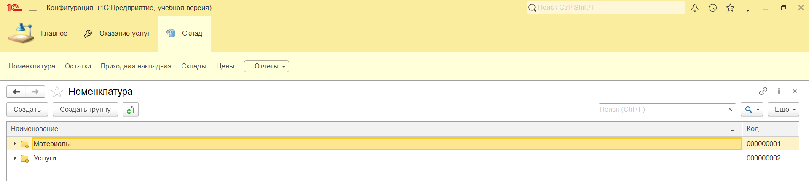
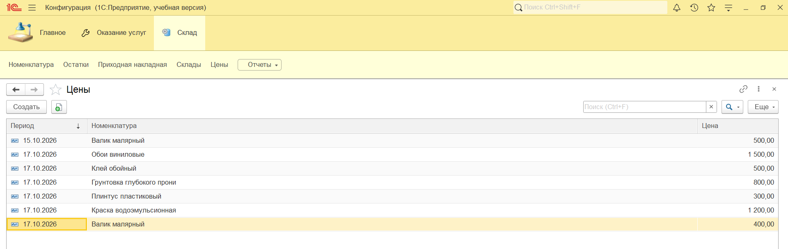

### Документы
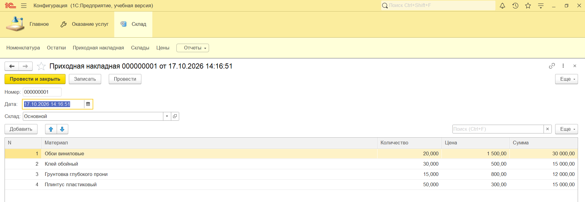
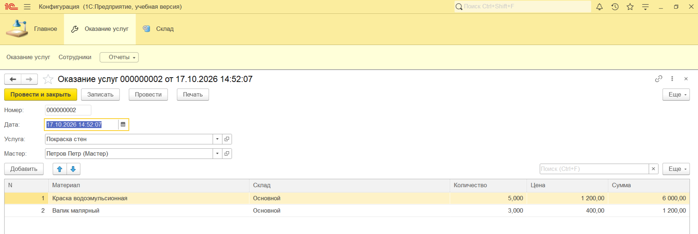

### Контроль остатков (ошибка при проведении)
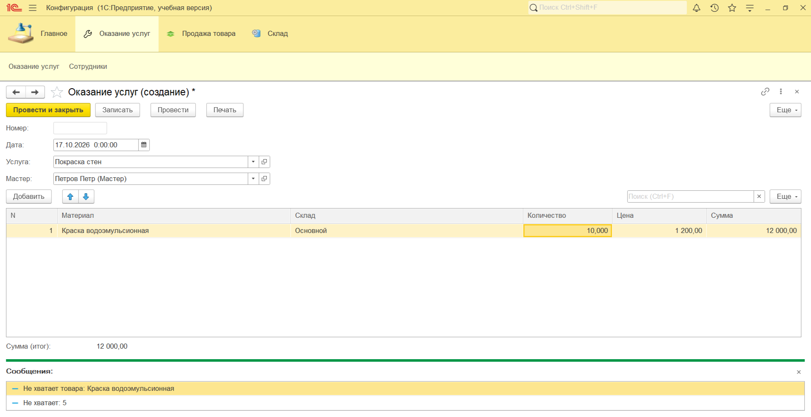

### Отчёты
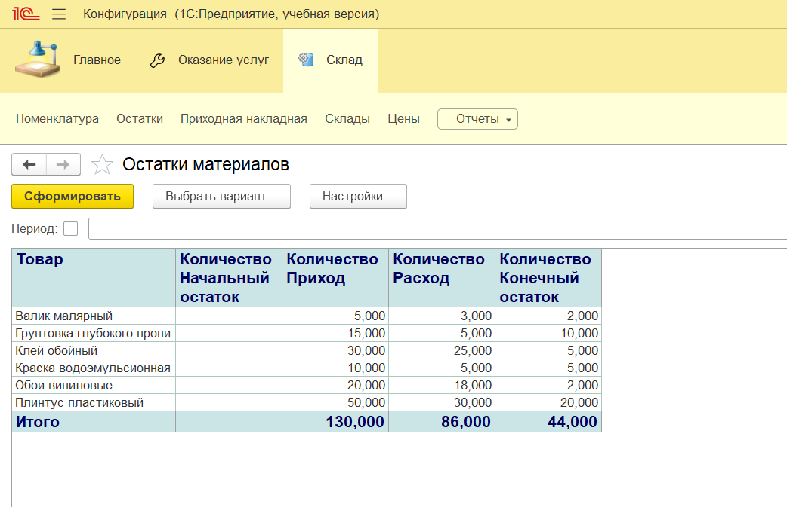
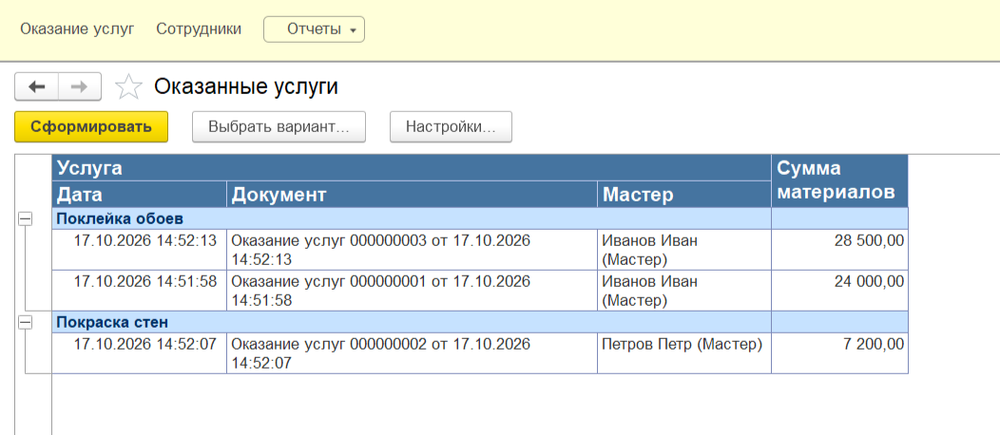

### Код и СКД
#### Контроль остатков (запрос и проверка)
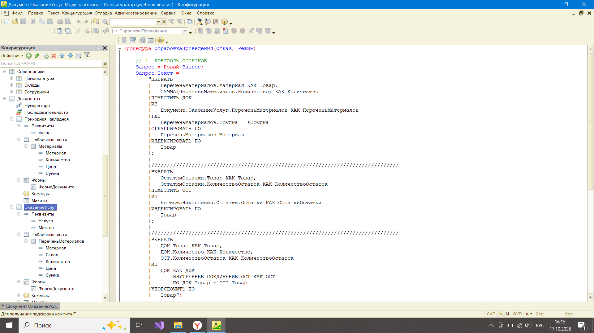
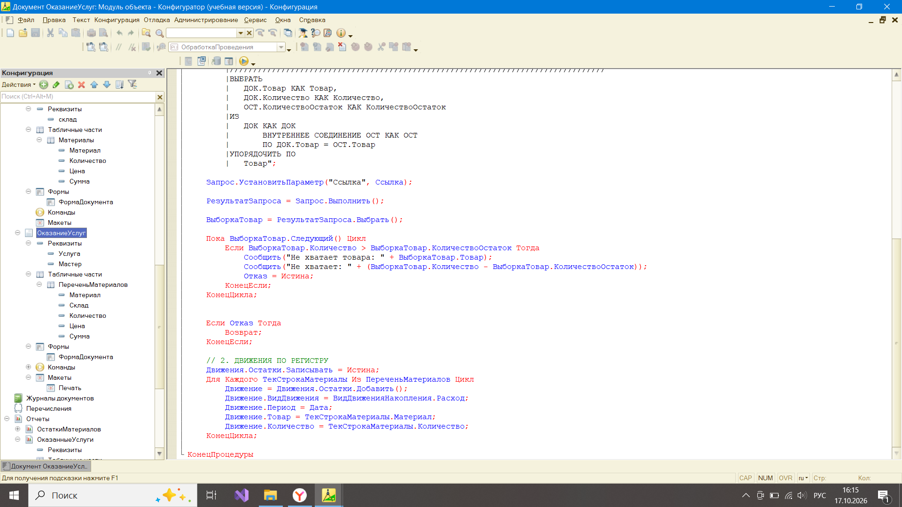

#### Общие модули
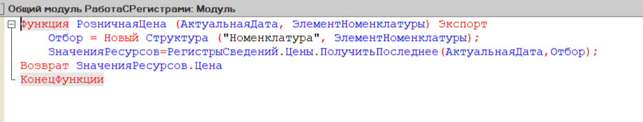
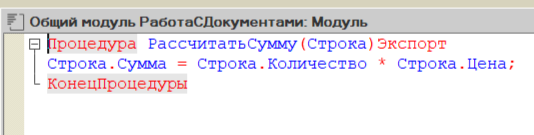

#### Автозаполнение цены в форме и суммы
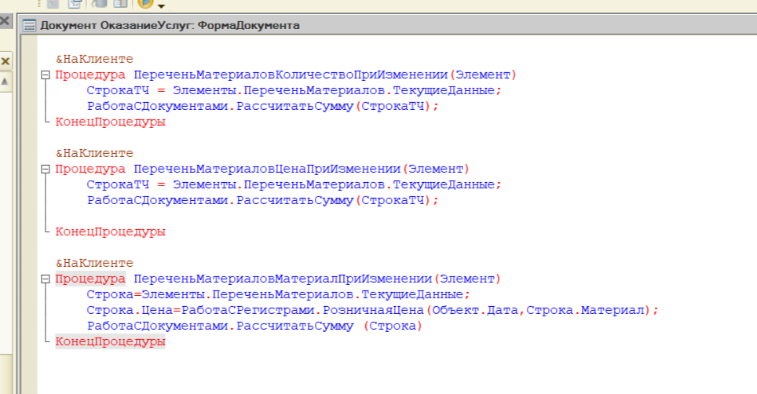

#### Печатная форма
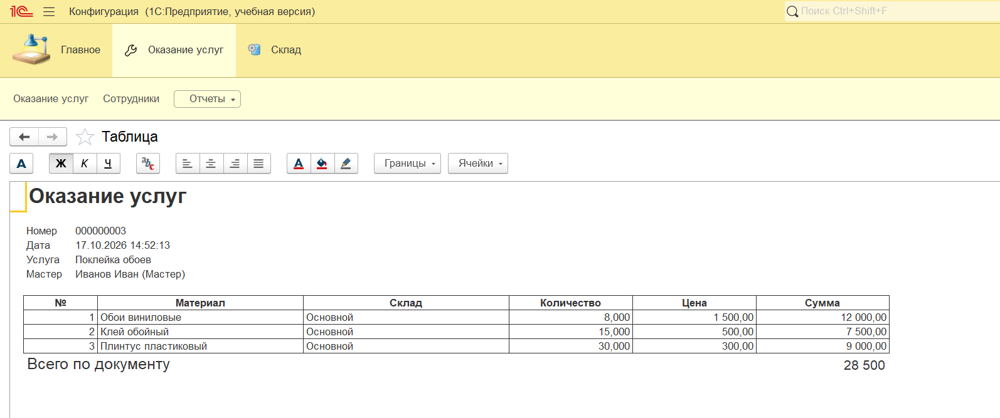

#### Настройки СКД
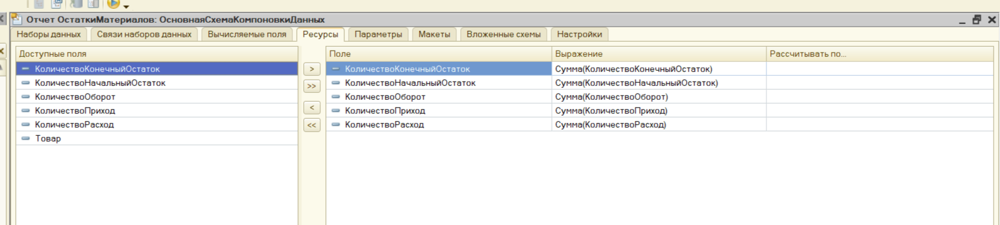
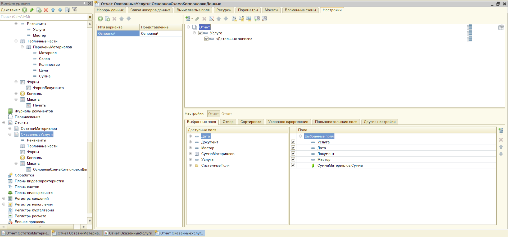

## Как развернуть
Конфигурация выгружена в файлы. Чтобы развернуть:
1. Создать новую пустую базу в 1С:Предприятие.
2. Открыть Конфигуратор.
3. **Конфигурация, Загрузить конфигурацию из файлов**, выбрать папку `src/`.
4. Обновить конфигурацию базы данных (F7).
5. В корне лежит файл `base.dt` — готовая база с тестовыми данными.

## Чему я научилась
- Работать с общими модулями (клиентскими и серверными)
- Строить запросы с временными таблицами и индексами
- Реализовывать контроль отрицательных остатков при проведении
- Использовать периодические регистры сведений для хранения цен, подставлять актуальные цены в документ
- Программно выводить печатные формы через макеты
- Настраивать параметры и структуру отчётов в СКД